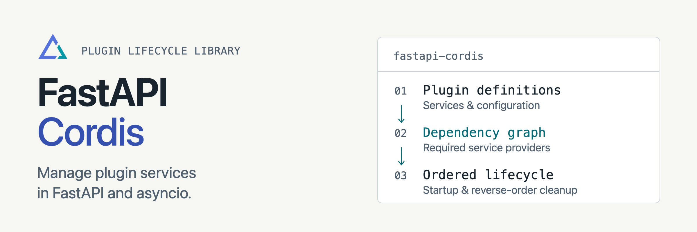

<p align="center">
<picture>
  <source media="(prefers-color-scheme: dark)" srcset="docs/assets/readme-banner-dark.png">
  <source media="(prefers-color-scheme: light)" srcset="docs/assets/readme-banner-light.png">
  
</picture>
</p>

# fastapi-cordis

[](https://github.com/toolframe/fastapi-cordis/actions/workflows/ci.yml?query=branch%3Amain)

Manage the lifecycle of Python plugin services in FastAPI and asyncio apps.
Declare dependencies; the runtime orders startup and waits for callers before cleanup.

## Quick start

Use Python 3.11+ in a virtual environment:

```sh
python -m pip install fastapi-cordis uvicorn
```

Save as `demo.py`:

```python
from collections.abc import Callable
from typing import Annotated

from fastapi import Depends, FastAPI
from fastapi_cordis import Plugin, PluginContext, PluginManager, install, service


async def greeting(ctx: PluginContext):
    return lambda name: f"Hello, {name}"


app = FastAPI()
install(app, PluginManager([Plugin("greeting", greeting)]))


@app.get("/hello/{name}")
async def hello(
    name: str,
    greet: Annotated[Callable[[str], str], Depends(service("greeting"))],
):
    return {"message": greet(name)}
```

```sh
python -m uvicorn demo:app --host 127.0.0.1
```

`GET /hello/Ada` returns `{"message":"Hello, Ada"}`; `GET /plugins` reports state.

**Scope:** trusted Python services on one asyncio loop. The host owns package
installation, isolation, persistence and coordination between server workers.
Management writes are opt-in and require host-supplied authorization.

Inspired by [Cordis](https://github.com/cordiverse/cordis); this independent Python
implementation does not run JavaScript Cordis plugins.

## Guides

| I want to... | Start here |
| --- | --- |
| Define plugins and resources | [Plugins](docs/plugins.md) / [Services](docs/services.md) |
| Handle lifecycle and events | [Lifecycle](docs/lifecycle.md) / [Events](docs/events.md) |
| Integrate FastAPI | [HTTP and management](docs/fastapi.md) |
| Run an asyncio example | [Reactive example](examples/reactive.py) |
| Contribute or run checks | [Contributing](CONTRIBUTING.md) / [Verification](docs/ci.md) |
| Review version changes | [Changelog](CHANGELOG.md) |

[Releases](https://github.com/toolframe/fastapi-cordis/releases)

## License

[MIT](LICENSE).
